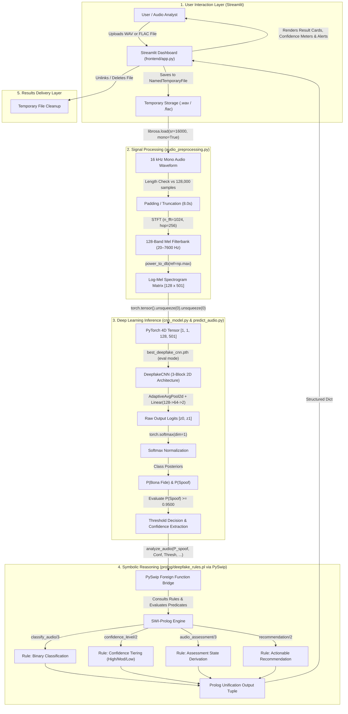
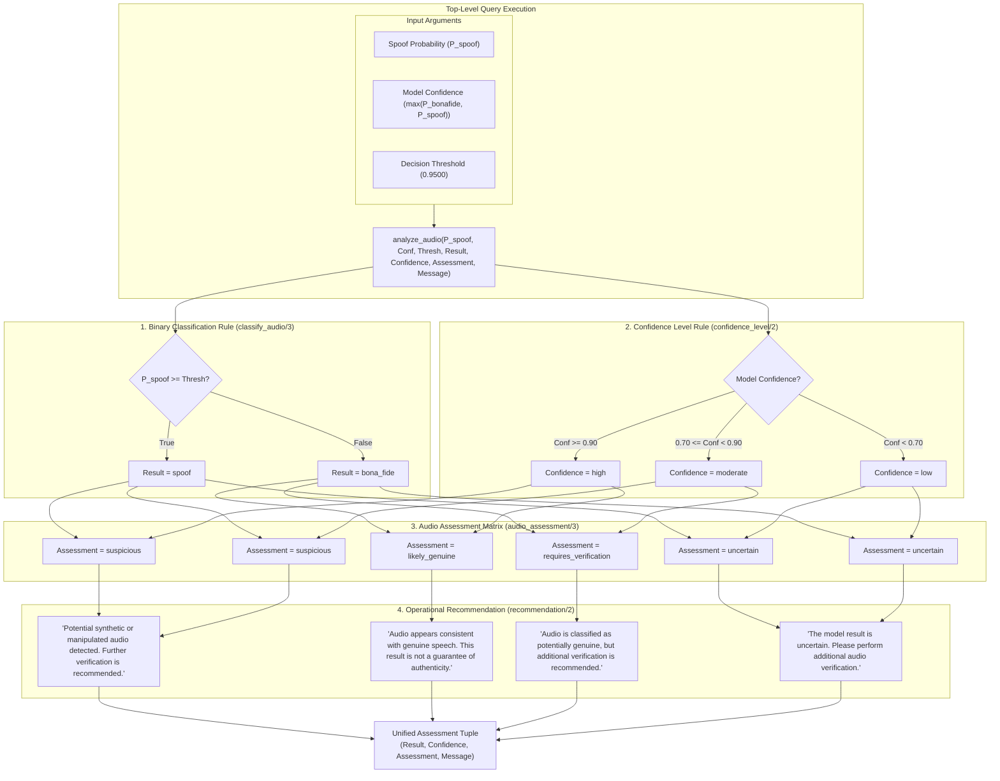

# An Intelligent Deepfake Voice Detection and Audio Authenticity Verification System Using Deep Learning and Prolog

[](https://www.python.org/)
[](https://pytorch.org/)
[](https://librosa.org/)
[](https://www.swi-prolog.org/)
[](https://github.com/yuce/pyswip)
[](https://streamlit.io/)
[](https://www.asvspoof.org/)
[](LICENSE)

An end-to-end neuro-symbolic artificial intelligence system designed to detect synthesized, cloned, and manipulated human speech. The architecture couples a custom **2D Convolutional Neural Network (CNN)** trained on **Log-Mel Spectrograms** with a declarative **SWI-Prolog Knowledge Base** executed via **PySwip**. While deep learning captures complex acoustic artifacts in spectral representations, first-order logic provides deterministic classification boundaries, model confidence categorization, and transparent contextual recommendations through an interactive **Streamlit** web dashboard.

---

## Table of Contents

1. [Project Overview](#1-project-overview)
2. [Problem Statement](#2-problem-statement)
3. [Project Objectives](#3-project-objectives)
4. [Key Features](#4-key-features)
5. [Technologies and Tools](#5-technologies-and-tools)
6. [System Architecture](#6-system-architecture)
7. [Detailed Processing Workflow](#7-detailed-processing-workflow)
8. [Audio Preprocessing and Feature Extraction](#8-audio-preprocessing-and-feature-extraction)
9. [CNN Architecture](#9-cnn-architecture)
10. [Model Training Methodology](#10-model-training-methodology)
11. [Prolog Knowledge Base and Reasoning](#11-prolog-knowledge-base-and-reasoning)
12. [CNN and Prolog Integration](#12-cnn-and-prolog-integration)
13. [Streamlit Frontend](#13-streamlit-frontend)
14. [Dataset Description](#14-dataset-description)
15. [Model Evaluation and Performance](#15-model-evaluation-and-performance)
16. [Confusion Matrix and Performance Metrics](#16-confusion-matrix-and-performance-metrics)
17. [Project Directory Structure](#17-project-directory-structure)
18. [Installation Requirements](#18-installation-requirements)
19. [Setup and Execution Instructions](#19-setup-and-execution-instructions)
20. [Sample Output](#20-sample-output)
21. [User Interface Screenshots](#21-user-interface-screenshots)
22. [Limitations](#22-limitations)
23. [Future Enhancements](#23-future-enhancements)
24. [Conclusion](#24-conclusion)

---

## 1. Project Overview

The rapid advancement of deep generative modeling—specifically neural vocoders, diffusion models, generative adversarial networks (GANs), and unit-selection concatenative speech synthesis—has made voice cloning accessible, convincing, and scalable. Synthetic speech can faithfully replicate the pitch, formant frequencies, cadence, and vocal tract idiosyncrasies of target individuals. This capability poses severe security risks, including identity theft, financial fraud (voice phishing or *vishing*), social engineering, executive impersonation, and evidence tampering.

Traditional defense systems rely exclusively on pure deep learning classifiers. While these statistical models can detect subtle acoustic anomalies, they function as non-transparent "black boxes": raw probabilities are prone to poor calibration, offer zero explainability, and lack verifiable operational guardrails. 

This project implements a **hybrid neuro-symbolic framework** bridging perception and reasoning:
* **Perception (Deep Learning):** A 3-block 2D Convolutional Neural Network extracts spatial and temporal spectral patterns from high-resolution Log-Mel spectrograms to compute class posterior probabilities.
* **Reasoning (Symbolic AI):** A declarative first-order logic engine (SWI-Prolog) processes model confidence and posterior distributions against calibrated operational thresholds to deduce risk tiers, evaluate evidential certainty, and generate contextual recommendations.

---

## 2. Problem Statement

Modern audio deepfakes leverage advanced Text-to-Speech (TTS) and Voice Conversion (VC) pipelines that synthesize speech indistinguishable to the human ear. However, deep neural audio synthesis leaves mathematical, temporal, and spectral footprints:
* Phase discontinuities and harmonic distortion introduced by short-time Fourier transform (STFT) reconstruction.
* High-frequency cutoff artifacts and robotic timbre produced by acoustic models and vocoders (e.g., WaveNet, HiFi-GAN, FastSpeech).
* Unnatural pitch transitions, missing micro-prosody, and breath pause anomalies.

Conventional software tools suffer from critical shortcomings:
1. **Opaque Decisions:** End-users receive a raw probability without insight into why an audio recording is deemed suspicious.
2. **Threshold Sensitivity:** Operating under a standard 0.50 threshold frequently leads to extreme false-positive or false-negative rates in imbalanced production datasets.
3. **Absence of Actionable Guidance:** Systems rarely provide policy-level advice on whether audio should be rejected outright, accepted, or escalated for forensic secondary review.

This project addresses these gaps by integrating continuous acoustic pattern recognition with formal, deterministic logic-based reasoning.

---

## 3. Project Objectives

1. **Standardized Audio Signal Processing:** Establish an acoustic ingestion pipeline to normalize arbitrary speech files into uniform, 16 kHz single-channel, fixed-duration Log-Mel representations.
2. **Deep Acoustic Feature Learning:** Design and train a lightweight 2D Convolutional Neural Network capable of identifying subtle vocoder artifacts and synthetic speech patterns.
3. **Empirical Threshold Optimization:** Calibrate decision thresholds using development data to mitigate the impact of class imbalance on classification boundaries.
4. **Symbolic Knowledge Representation:** Construct a Prolog knowledge base with declarative rules that map continuous probability vectors into human-understandable qualitative assessments and operational advisories.
5. **Bidirectional Software Integration:** Develop a low-latency bridge using PySwip to execute Prolog queries from Python runtimes seamlessly.
6. **Accessible Web Dashboard:** Build a clean, responsive Streamlit interface that enables non-technical operators to upload recordings, listen to source audio, and inspect unified neural and symbolic audit reports.

---

## 4. Key Features

* **Neuro-Symbolic Architecture:** Combines sub-symbolic statistical perception (PyTorch CNN) with symbolic reasoning (SWI-Prolog).
* **Deterministic Audio Ingestion:** Automatically standardizes input audio to 16,000 Hz mono and pads or truncates signals to exactly 8.0 seconds (128,000 samples).
* **Compact 3-Block 2D CNN:** Structured with convolutional feature extractors, Batch Normalization, ReLU non-linearities, Max Pooling, and Global Adaptive Average Pooling.
* **Calibrated Decision Boundary:** Implements an optimized decision threshold ($T = 0.9500$) tailored to the imbalanced distribution of synthetic speech attacks.
* **Multi-Tier Prolog Inferencing:**
  * Categorizes model confidence into `high`, `moderate`, and `low` tiers.
  * Formulates holistic qualitative assessments (`suspicious`, `likely_genuine`, `requires_verification`, `uncertain`).
  * Emits human-readable operational recommendations.
* **Robust PySwip Integration:** Automates dynamic string query construction, type parsing, and structured dictionary output extraction.
* **Streamlit Web Application:** Features responsive file handling, real-time playback, progress bars for class probabilities, and color-coded alert cards.
* **Autonomous Batch Testing:** Includes dedicated evaluation and investigation scripts (`investigate_audio.py`) for validation on benchmark recordings.

---

## 5. Technologies and Tools

| Component | Technology / Library | Version / Spec | Primary Function |
| :--- | :--- | :--- | :--- |
| **Programming Language** | Python | `>= 3.10` (Tested on `3.13`) | Core execution runtime and glue code |
| **Deep Learning Framework** | PyTorch | `2.15.0` | CNN architecture definition, tensor operations, model checkpoint loading |
| **Audio Processing** | Librosa | `1.0.0` | Audio decoding, resampling, STFT computation, Log-Mel spectrogram generation |
| **Audio File I/O** | SoundFile | `0.14.0` | FLAC/WAV reading backend for high-fidelity audio streams |
| **Symbolic Logic Engine** | SWI-Prolog | `9.x` (64-bit) | Declarative knowledge representation and rule-based query resolution |
| **Python-Prolog Bridge** | PySwip | `0.3.3` | Bidirectional foreign language interface between CPython and SWI-Prolog C-API |
| **Web Interface** | Streamlit | `1.67.0` | Interactive web dashboard, audio playback, and visual reporting |
| **Scientific Computing** | NumPy | `2.5.4` | Matrix manipulation, zero-padding, and dimensional array reshaping |
| **Data Analysis** | Pandas | `3.1.1` | Tabular metric processing and batch evaluation auditing |
| **Machine Learning Utilities**| Scikit-learn | `1.9.1` | Evaluation metrics computation (ROC-AUC, Macro F1, Precision, Recall) |
| **Benchmark Dataset** | ASVspoof 2019 LA | Logical Access Split | Standardized corpus for logical speech synthesis and voice conversion detection |

---

## 6. System Architecture

The following diagram illustrates the complete end-to-end data processing and reasoning flow across all system boundaries:



---

## 7. Detailed Processing Workflow

1. **User Audio Submission:** The analyst uploads a speech recording through the Streamlit web dashboard. The system accepts `.wav` and `.flac` formats and renders an HTML5 audio player for immediate acoustic inspection.
2. **Temporary Secure Persistence:** The file is persisted in a secured operating system temporary directory using Python's `tempfile.NamedTemporaryFile` with explicit suffix preservation.
3. **Signal Decoding and Resampling:** `audio_preprocessing.py` utilizes Librosa to decode the file, enforce single-channel monophonic audio, and resample the signal to a fixed target rate of $16\text{ kHz}$.
4. **Temporal Standardization:** The digital signal length is verified against $N_{target} = 128,000$ samples ($8.0\text{ seconds} \times 16,000\text{ samples/sec}$). If the duration is shorter, the array is right-padded with zeros; if longer, it is truncated.
5. **Log-Mel Spectrogram Transformation:** A Short-Time Fourier Transform (STFT) with a window length of 1024 and hop size of 256 is passed through a 128-channel Mel-scale triangular filterbank ($20\text{ Hz} - 7600\text{ Hz}$), then transformed via `librosa.power_to_db` into decibel units relative to the signal peak. The resulting matrix has dimensions of $128 \times 501$.
6. **Tensor Construction and Hardware Dispatch:** The NumPy array is converted into a PyTorch single-precision float tensor, expanded by two singleton dimensions to form a 4D batch tensor of shape `(1, 1, 128, 501)`, and transferred to the execution device (`cuda` or `cpu`).
7. **Neural Forward Pass:** The tensor traverses three convolutional blocks, global average pooling, and fully connected linear layers. Softmax normalization yields posterior probabilities $P(\text{Bona Fide})$ and $P(\text{Spoof})$.
8. **Threshold Evaluation:** The model evaluates $P(\text{Spoof})$ against the calibrated decision threshold ($0.9500$). Model confidence is recorded as $\max(P(\text{Bona Fide}), P(\text{Spoof}))$.
9. **Prolog Query Construction:** `cnn_prolog_integration.py` builds a formatted first-order logic goal:
   $$\text{analyze\_audio}(P_{\text{spoof}}, C, T, \text{Result}, \text{Confidence}, \text{Assessment}, \text{Message})$$
10. **Symbolic Inference:** SWI-Prolog executes backward chaining across the knowledge base rules to unify the output variables.
11. **Visual Reporting & Lifecycle Cleanup:** Streamlit extracts the unified result dictionary, updates the interface cards and confidence progress bars, and unlinks the temporary audio file in a `finally` block to prevent resource leaks.

---

## 8. Audio Preprocessing and Feature Extraction

The human auditory system perceives frequencies non-linearly, exhibiting higher resolution at low frequencies than at high frequencies. Deep speech synthesis algorithms frequently introduce subtle phase mismatches and abnormal harmonic distributions that are prominently visible in time-frequency representations. 

The Log-Mel Spectrogram converts linear frequency spectra into the Mel scale, concentrating acoustic information where human speech formants reside while retaining high-frequency vocoder cues.

### Acoustic Parameter Configuration

The parameters defined in [integration/audio_preprocessing.py](integration/audio_preprocessing.py) are:

| Parameter | Configuration Value | Justification & Architectural Impact |
| :--- | :--- | :--- |
| **Sampling Rate ($f_s$)** | $16,000\text{ Hz}$ ($16\text{ kHz}$) | Standard telephonic and ASV benchmark rate; captures frequencies up to $8\text{ kHz}$ (Nyquist). |
| **Channel Count** | $1$ (Monophonic) | Eliminates stereo panning artifacts; standardizes vocal track analysis. |
| **Target Duration ($T$)** | $8.0\text{ seconds}$ | Provides sufficient temporal context for long-term prosodic and breathing evaluation. |
| **Target Sample Count** | $128,000\text{ samples}$ | Computed as $16,000\text{ samples/sec} \times 8.0\text{ sec}$. |
| **FFT Window Size ($N_{\text{fft}}$)** | $1024\text{ samples}$ | Balance between frequency resolution ($\approx 15.625\text{ Hz/bin}$) and temporal localization. |
| **Hop Length ($H$)** | $256\text{ samples}$ | $75\%$ overlap ($16\text{ ms}$ step size); produces smooth temporal frame continuity. |
| **Mel Filter Bins ($N_{\text{mels}}$)** | $128$ | Matches the input height expected by the 2D CNN feature extractor. |
| **Frequency Bounds** | $f_{\min} = 20\text{ Hz}$, $f_{\max} = 7600\text{ Hz}$ | Filters DC drift and ultra-low hum; bounds analysis below the $8\text{ kHz}$ Nyquist limit. |
| **Power Exponent** | $2.0$ | Computes the power spectral density ($|STFT|^2$) prior to Mel bin integration. |
| **Decibel Transformation** | `librosa.power_to_db(..., ref=np.max)` | Logarithmically compresses dynamic range to decibels relative to peak amplitude. |
| **Output Feature Matrix** | $(128, 501)$ | Height $= 128$ Mel bins; Width $= 1 + \lfloor 128000 / 256 \rfloor = 501$ time frames. |

### Padding and Truncation Logic

```python
# Extract audio and force 16 kHz mono
audio, sr = librosa.load(audio_path, sr=16000, mono=True)

# Pad short audio or truncate long audio to exactly 128,000 samples
if len(audio) < 128000:
    audio = np.pad(audio, (0, 128000 - len(audio)))
else:
    audio = audio[:128000]
```

---

## 9. CNN Architecture

The neural backbone is defined in [integration/cnn_model.py](integration/cnn_model.py) as `DeepfakeCNN`. It is a specialized 2D Convolutional Neural Network engineered to learn local spectral-temporal correlations directly from Log-Mel feature maps without exorbitant parameter bloat.

### Structural Overview

```mermaid
flowchart TD
    In["Input Tensor<br/><b>Log-Mel Spectrogram</b><br/>(B, 1, 128, 501)"] --> CB1

    subgraph CB1_Sub ["Convolutional Block 1"]
        CB1["nn.Conv2d(1, 32, kernel_size=3, padding=1)<br/>Output: (B, 32, 128, 501)"]
        CB1 --> BN1["nn.BatchNorm2d(32)"]
        BN1 --> ACT1["nn.ReLU()"]
        ACT1 --> MP1["nn.MaxPool2d(kernel_size=2)<br/>Output: (B, 32, 64, 250)"]
    end

    MP1 --> CB2

    subgraph CB2_Sub ["Convolutional Block 2"]
        CB2["nn.Conv2d(32, 64, kernel_size=3, padding=1)<br/>Output: (B, 64, 64, 250)"]
        CB2 --> BN2["nn.BatchNorm2d(64)"]
        BN2 --> ACT2["nn.ReLU()"]
        ACT2 --> MP2["nn.MaxPool2d(kernel_size=2)<br/>Output: (B, 64, 32, 125)"]
    end

    MP2 --> CB3

    subgraph CB3_Sub ["Convolutional Block 3"]
        CB3["nn.Conv2d(64, 128, kernel_size=3, padding=1)<br/>Output: (B, 128, 32, 125)"]
        CB3 --> BN3["nn.BatchNorm2d(128)"]
        BN3 --> ACT3["nn.ReLU()"]
        ACT3 --> MP3["nn.MaxPool2d(kernel_size=2)<br/>Output: (B, 128, 16, 62)"]
    end

    MP3 --> GAP

    subgraph Pool_Sub ["Spatial Dimension Reduction"]
        GAP["nn.AdaptiveAvgPool2d((1, 1))<br/>Output: (B, 128, 1, 1)"]
    end

    GAP --> FC

    subgraph Classifier_Sub ["Dense Classifier Block"]
        FC["nn.Flatten()<br/>Output: (B, 128)"]
        FC --> LIN1["nn.Linear(128, 64)<br/>Output: (B, 64)"]
        LIN1 --> ACT4["nn.ReLU()"]
        ACT4 --> DO["nn.Dropout(p=0.40)"]
        DO --> LIN2["nn.Linear(64, 2)<br/>Output: (B, 2)"]
    end

    LIN2 --> LogitsOut["Raw Classification Logits<br/>Class 0: Bona Fide | Class 1: Spoof"]
```



### Detailed Layer Specification

| Layer / Stage | Sub-Operations | Kernel / Parameters | Activation / Rate | Output Shape $(B, C, H, W)$ |
| :--- | :--- | :--- | :--- | :--- |
| **Input** | Audio Tensor | — | — | $(B, 1, 128, 501)$ |
| **Conv Block 1** | `Conv2d` | $3 \times 3$, Stride $1$, Padding $1$ | — | $(B, 32, 128, 501)$ |
| | `BatchNorm2d` | $32$ Channels | — | $(B, 32, 128, 501)$ |
| | `ReLU` | Element-wise | $\max(0, x)$ | $(B, 32, 128, 501)$ |
| | `MaxPool2d` | $2 \times 2$, Stride $2$ | Downsample $\div 2$ | $(B, 32, 64, 250)$ |
| **Conv Block 2** | `Conv2d` | $3 \times 3$, Stride $1$, Padding $1$ | — | $(B, 64, 64, 250)$ |
| | `BatchNorm2d` | $64$ Channels | — | $(B, 64, 64, 250)$ |
| | `ReLU` | Element-wise | $\max(0, x)$ | $(B, 64, 64, 250)$ |
| | `MaxPool2d` | $2 \times 2$, Stride $2$ | Downsample $\div 2$ | $(B, 64, 32, 125)$ |
| **Conv Block 3** | `Conv2d` | $3 \times 3$, Stride $1$, Padding $1$ | — | $(B, 128, 32, 125)$ |
| | `BatchNorm2d` | $128$ Channels | — | $(B, 128, 32, 125)$ |
| | `ReLU` | Element-wise | $\max(0, x)$ | $(B, 128, 32, 125)$ |
| | `MaxPool2d` | $2 \times 2$, Stride $2$ | Downsample $\div 2$ | $(B, 128, 16, 62)$ |
| **Global Pool** | `AdaptiveAvgPool2d`| Spatial target $(1, 1)$ | Average across $H \times W$| $(B, 128, 1, 1)$ |
| **Classifier** | `Flatten` | Flatten spatial dims | — | $(B, 128)$ |
| | `Linear` | $128 \to 64$ | — | $(B, 64)$ |
| | `ReLU` | Element-wise | $\max(0, x)$ | $(B, 64)$ |
| | `Dropout` | Regularization | $p = 0.40$ ($40\%$ drop) | $(B, 64)$ |
| | `Linear` | $64 \to 2$ | Linear Logits | $(B, 2)$ |

### Mathematical Design Highlights

* **Same-Padding Convolutions:** By enforcing $\text{padding} = 1$ with a $3 \times 3$ kernel, spatial dimensions remain invariant during convolutions, letting pooling layers govern downsampling deterministically.
* **Batch Normalization:** Stabilizes the distribution of layer inputs through mini-batch standardization, counteracting internal covariate shift and accelerating convergence.
* **Global Adaptive Average Pooling:** Replaces large, parameter-heavy fully connected matrices with spatial averaging $\frac{1}{H \times W}\sum_{h,w} x_{c,h,w}$. This dramatically suppresses overfitting and ensures invariance to minor temporal shifts.
* **Regularization:** A dropout rate of $0.40$ in the classifier prevents co-adaptation of hidden units prior to final logit projection.

---

## 10. Model Training Methodology

The CNN was trained on the ASVspoof 2019 Logical Access training partition using PyTorch. Training details extracted directly from model checkpoint metadata are documented below.

### Hyperparameters and Setup

* **Optimizer:** Adam ($\beta_1 = 0.9$, $\beta_2 = 0.999$, $\epsilon = 10^{-8}$)
* **Learning Rate:** $\eta = 0.0003$ ($3 \times 10^{-4}$)
* **Weight Decay:** $0.0$
* **Loss Function:** `nn.CrossEntropyLoss()`
* **Primary Optimization Metric:** Macro F1-Score on the development set
* **Best Model Checkpoint:** Epoch 5 (`best_deepfake_cnn.pth`)

### Empirical Training Progression

The table below reflects the actual training logs embedded within the checkpoint file:

| Epoch | Training Loss | Development Loss | Training Accuracy | Development Accuracy | Development Macro F1 | Bona Fide Recall | Spoof Recall |
| :---: | :---: | :---: | :---: | :---: | :---: | :---: | :---: |
| **1** | $0.4674$ | $1.5696$ | $78.64\%$ | $26.28\%$ | $0.2603$ | $100.00\%$ | $17.86\%$ |
| **2** | $0.2900$ | $2.3547$ | $88.70\%$ | $16.65\%$ | $0.1653$ | $100.00\%$ | $7.13\%$ |
| **3** | $0.2249$ | $0.6816$ | $91.36\%$ | $90.16\%$ | $0.5604$ | $10.05\%$ | $99.31\%$ |
| **4** | $0.1728$ | $1.2920$ | $93.52\%$ | $89.74\%$ | $0.4730$ | $0.00\%$ | $100.00\%$ |
| **5** | **0.1498** | **0.1889** | **94.45%** | **93.64%** | **0.7592** | **38.30%** | **99.96%** |

### Decision Threshold Calibration

In binary classification under severe class imbalance, the standard default threshold ($0.50$) is rarely optimal. The ASVspoof dataset contains significantly more spoof samples than bona fide samples.

Using development set sweeping recorded in [models/saved_models/final_model_config.json](models/saved_models/final_model_config.json):
* **Default Decision Threshold ($0.50$):** Produced a development Macro F1 of $0.7592$.
* **Optimized Decision Threshold ($T = 0.9500$):** Elevated development Macro F1 to **$0.9050$** and balanced accuracy to **$87.56\%$**.
* **Decision Rule:**
  $$\hat{y} = \begin{cases} \text{spoof}, & \text{if } P(\text{Spoof}) \ge 0.9500 \\ \text{bona\_fide}, & \text{if } P(\text{Spoof}) < 0.9500 \end{cases}$$

---

## 11. Prolog Knowledge Base and Reasoning

While the CNN outputs continuous posterior probabilities, human analysts and organizational security protocols require declarative, verifiable reasoning. The symbolic knowledge base is implemented in [prolog/deepfake_rules.pl](prolog/deepfake_rules.pl).

### Prolog Knowledge Engine Flowchart



### Knowledge Base Predicate Specifications

#### 1. Audio Classification
Determines the nominal classification based on the calibrated threshold:
```prolog
classify_audio(Probability, Threshold, spoof) :-
    Probability >= Threshold.

classify_audio(Probability, Threshold, bona_fide) :-
    Probability < Threshold.
```

#### 2. Confidence Level Stratification
Discretizes continuous confidence $\max(P_0, P_1)$ into ordinal semantic tiers:
```prolog
confidence_level(Probability, high) :-
    Probability >= 0.90.

confidence_level(Probability, moderate) :-
    Probability >= 0.70,
    Probability < 0.90.

confidence_level(Probability, low) :-
    Probability < 0.70.
```

#### 3. Audio Assessment Derivation
Unifies classification with confidence to determine the security audit state:
```prolog
audio_assessment(spoof, high, suspicious).
audio_assessment(spoof, moderate, suspicious).
audio_assessment(spoof, low, uncertain).

audio_assessment(bona_fide, high, likely_genuine).
audio_assessment(bona_fide, moderate, requires_verification).
audio_assessment(bona_fide, low, uncertain).
```

#### 4. Operational Recommendations
Assigns precise, legally cautious advisories according to the assessment state:
```prolog
recommendation(suspicious,
    'Potential synthetic or manipulated audio detected. Further verification is recommended.').

recommendation(likely_genuine,
    'Audio appears consistent with genuine speech. This result is not a guarantee of authenticity.').

recommendation(requires_verification,
    'Audio is classified as potentially genuine, but additional verification is recommended.').

recommendation(uncertain,
    'The model result is uncertain. Please perform additional audio verification.').
```

#### 5. Main Inference Entry Point
Orchestrates the entire deduction sequence in a single unification query:
```prolog
analyze_audio(
    SpoofProbability,
    ModelConfidence,
    Threshold,
    Result,
    Confidence,
    Assessment,
    Message
) :-
    classify_audio(SpoofProbability, Threshold, Result),
    confidence_level(ModelConfidence, Confidence),
    audio_assessment(Result, Confidence, Assessment),
    recommendation(Assessment, Message).
```

---

## 12. CNN and Prolog Integration

The interface between the Python neural runtime and the SWI-Prolog reasoning engine is managed by [integration/cnn_prolog_integration.py](integration/cnn_prolog_integration.py) through `pyswip`.

### Integration Mechanism

1. **Foreign Engine Consultation:** At module import, `pyswip.Prolog` consults the absolute POSIX path of `deepfake_rules.pl`.
2. **Precision Floating-Point Formatting:** Floating-point values extracted from PyTorch are formatted to 10 decimal places (`.10f`) to prevent rounding errors or Prolog syntax errors:
   ```python
   query = (
       f"analyze_audio("
       f"{spoof_probability:.10f}, "
       f"{model_confidence:.10f}, "
       f"{threshold:.10f}, "
       f"Result, Confidence, Assessment, Message)"
   )
   ```
3. **Query Resolution:** The query returns a Python list of variable binding dictionaries:
   ```python
   results = list(prolog.query(query))
   result = results[0]
   ```
4. **Result Packaging:** The final output is aggregated into a strongly typed Python dictionary containing both sub-symbolic and symbolic outputs.

---

## 13. Streamlit Frontend

The web dashboard is implemented in [frontend/app.py](frontend/app.py) using Streamlit. It provides a clean, responsive graphical interface for testing audio files.

### Interface Highlights

* **Single-Page Reactive Layout:** Configured with `layout="wide"` and a collapsible sidebar.
* **Embedded CSS Styling:** Custom dark-theme cards with subtle green and red border accents (`.genuine-card`, `.spoof-card`) for rapid visual orientation.
* **Native Audio Playback:** Renders the uploaded audio file via `st.audio()` so operators can perform subjective acoustic listening alongside algorithmic analysis.
* **Interactive Probability Visualizers:** Pair of `st.metric` displays coupled with `st.progress` bars that dynamically track bona fide and spoof probabilities between $0.0\%$ and $100.0\%$.
* **Prolog Reasoning Cards:** Dedicated sections presenting the symbolic classification, confidence rating (`HIGH`, `MODERATE`, `LOW`), assessment status, and full recommendation text.
* **Defensive Lifecycle Cleanup:** Uses `tempfile.NamedTemporaryFile` inside a `try...finally` block to ensure uploaded files are deleted from the host disk immediately after processing.

---

## 14. Dataset Description

The system was developed and benchmarked on the globally recognized **ASVspoof 2019: Automatic Speaker Verification Spoofing and Countermeasures Challenge (Logical Access - LA Split)**.

### Dataset Partitions and Purpose

The ASVspoof 2019 LA corpus contains speech recordings categorized into bona fide human speech and spoofed speech generated by state-of-the-art voice conversion (VC) and text-to-speech (TTS) algorithms.

| Partition | Bona Fide Recordings | Spoofed Recordings | Total Recordings | Specific Role in System Lifecycle |
| :--- | :---: | :---: | :---: | :--- |
| **Training (Train)** | $2,580$ | $22,800$ | $25,380$ | Optimization of convolutional filters, weights, and batch norm parameters across known attacks (A01–A06). |
| **Development (Dev)** | $2,548$ | $22,296$ | $24,844$ | Hyperparameter validation, early stopping checkpoints, and decision threshold calibration ($T = 0.9500$). |
| **Evaluation (Eval)** | $7,355$ | $63,882$ | $71,237$ | Unbiased evaluation on unseen speech synthesis systems and acoustic attacks (A07–A19). |
| **Total** | **12,483** | **108,978** | **121,461** | **Complete ASVspoof 2019 Logical Access Benchmark** |

> **Note on Dataset Availability:** In compliance with repository storage limits and academic licensing restrictions, the raw multi-gigabyte ASVspoof dataset is not stored within this GitHub repository. The `.gitignore` file explicitly excludes audio archives and raw data directories (`datasets/`, `test_audio/*.flac`, `test_audio/*.wav`).

---

## 15. Model Evaluation and Performance

The model was comprehensively evaluated on the entire unseen ASVspoof 2019 Logical Access evaluation split, comprising **71,237 recordings**.

### Evaluation Benchmark Summary

| Evaluation Metric | Benchmark Value | Technical Interpretation |
| :--- | :---: | :--- |
| **Total Evaluation Samples** | **71,237** | Exhaustive test set of unseen synthetic voices and genuine speakers. |
| **Overall Accuracy** | **92.31%** | Total proportion of correctly identified recordings ($\frac{65,756}{71,237}$). |
| **Balanced Accuracy** | **83.25%** | Unweighted arithmetic mean of Bona Fide Recall and Spoof Recall. |
| **Macro F1-Score** | **80.75%** | Harmonic balance between precision and recall across both classes equally. |
| **ROC-AUC** | **95.54%** | Area under the Receiver Operating Characteristic curve; excellent ranking separation. |
| **Average Precision (AP)** | **99.48%** | Area under the Precision-Recall curve, demonstrating exceptional spoof detection fidelity. |

---

## 16. Confusion Matrix and Performance Metrics

### Evaluation Confusion Matrix

The performance of the model on the 71,237 evaluation recordings under the optimized threshold ($T = 0.9500$) is represented below:

$$\text{Confusion Matrix} = \begin{bmatrix} 5283 & 2072 \\ 3409 & 60473 \end{bmatrix}$$

| Actual \ Predicted | Predicted Bona Fide | Predicted Spoof | Total Actual |
| :--- | :---: | :---: | :---: |
| **Actual Bona Fide** | **5,283** *(True Bona Fide)* | **2,072** *(False Spoof)* | **7,355** |
| **Actual Spoof** | **3,409** *(False Bona Fide)* | **60,473** *(True Spoof)* | **63,882** |
| **Total Predicted** | **8,692** | **62,545** | **71,237** |

### Per-Class Detailed Performance Metrics

| Evaluation Metric | Bona Fide Speech | Spoofed / Synthetic Speech | Macro Average |
| :--- | :---: | :---: | :---: |
| **Precision** | $\frac{5283}{5283 + 3409} = \mathbf{60.78\%}$ | $\frac{60473}{60473 + 2072} = \mathbf{96.69\%}$ | $78.74\%$ |
| **Recall / Sensitivity** | $\frac{5283}{5283 + 2072} = \mathbf{71.83\%}$ | $\frac{60473}{60473 + 3409} = \mathbf{94.66\%}$ | $\mathbf{83.25\%}$ *(Balanced Accuracy)* |
| **F1-Score** | $\mathbf{65.84\%}$ | $\mathbf{95.66\%}$ | $\mathbf{80.75\%}$ |
| **Class Distribution** | $7,355\text{ samples}$ ($10.32\%$) | $63,882\text{ samples}$ ($89.68\%$) | $71,237\text{ samples}$ ($100.0\%$) |

### Objective Performance Analysis

1. **Impact of Class Imbalance:** The evaluation set contains roughly 9 spoof recordings for every 1 genuine recording ($89.7\%$ vs $10.3\%$). The model successfully flags $60,473$ out of $63,882$ malicious spoof attacks ($94.66\%$ recall).
2. **Lower Recall for Bona Fide Recordings:** The model achieves a $71.83\%$ recall on bona fide recordings, misclassifying $2,072$ genuine files as synthetic. This occurs because the calibrated decision threshold ($0.9500$) prioritizes catching high-risk spoof attacks, and unseen acoustic recording conditions or background noise can trigger synthetic artifact detections.
3. **No Forensic Absolutism:** In accordance with responsible AI practices, the system outputs an automated screening assessment rather than definitive legal proof of authenticity. Borderline samples trigger the Prolog rule `requires_verification` or `uncertain` to prompt human forensic review.

---

## 17. Project Directory Structure

```
Deepfake-Voice-Detection/
├── frontend/
│   └── app.py                      # Streamlit interactive web dashboard
├── integration/
│   ├── audio_preprocessing.py      # Librosa 16kHz mono audio loading & Log-Mel extraction
│   ├── cnn_model.py                # PyTorch 3-block 2D CNN architecture definition
│   ├── cnn_prolog_integration.py   # PySwip bridge connecting PyTorch predictions to Prolog
│   ├── load_cnn.py                 # Checkpoint loader, device setup & threshold binding
│   ├── predict_audio.py            # Standalone CNN inference module with softmax thresholding
│   ├── test_audio_preprocessing.py # Validation test for audio feature tensor dimensions
│   └── test_prolog.py              # Unit test for Prolog engine consultation and reasoning
├── models/
│   └── saved_models/
│       ├── best_deepfake_cnn.pth   # Serialized PyTorch weights, optimizer state & history
│       └── final_model_config.json # Model metadata, Mel parameters & calibrated threshold
├── outputs/                        # Storage directory for local evaluation logs and outputs
├── prolog/
│   └── deepfake_rules.pl           # Declarative knowledge base (classification, confidence, advice)
├── test_audio/                     # Local sample recordings for quick verification
│   ├── bonafide1.flac ... bonafide5.flac
│   ├── spoof1.flac ... spoof5.flac
│   ├── LA_E_*.flac
│   └── sample.flac
├── investigate_audio.py            # Batch testing utility evaluating sample test recordings
├── .gitignore                      # Git exclusion rules (virtualenvs, checkpoints, audios)
└── README.md                       # Complete technical system documentation
```

---

## 18. Installation Requirements

### System Prerequisites

* **Operating System:** Windows 10 / Windows 11 (64-bit) (or Linux/macOS with SWI-Prolog shared libraries)
* **Python Runtime:** Python `3.10`, `3.11`, `3.12`, or `3.13` (64-bit architecture)
* **SWI-Prolog:** SWI-Prolog 64-bit (version 8.x or 9.x) installed on the system
* **Git:** Git CLI for repository cloning

### SWI-Prolog Requirement for PySwip

PySwip interfaces directly with SWI-Prolog's dynamic C-library (`libswipl.dll` on Windows). 
1. Download the 64-bit installer from the official portal: [https://www.swi-prolog.org/download/stable](https://www.swi-prolog.org/download/stable)
2. During installation, ensure the option **"Add SWI-Prolog to system PATH"** is selected.
3. Default installation directory on Windows: `C:\Program Files\swipl\bin`

---

## 19. Setup and Execution Instructions

Follow these step-by-step instructions to set up and run the system on Windows:

### Step 1: Clone the Repository

```powershell
git clone https://github.com/Vijay05092005/Deepfake-Voice-Detection.git
cd Deepfake-Voice-Detection
```

### Step 2: Create and Activate a Python Virtual Environment

```powershell
# Create a dedicated virtual environment
python -m venv venv

# Activate the virtual environment
.\venv\Scripts\Activate.ps1
```

> **Note for PowerShell Users:** If script execution is restricted, run: `Set-ExecutionPolicy -Scope Process -ExecutionPolicy Bypass`

### Step 3: Install Required Dependencies

Install the core dependencies into your virtual environment:

```powershell
python -m pip install --upgrade pip

pip install torch torchvision --index-url https://download.pytorch.org/whl/cpu
pip install librosa soundfile pyswip streamlit scikit-learn numpy pandas
```

*(Note: For GPU acceleration with NVIDIA CUDA, install the appropriate PyTorch CUDA build from [pytorch.org](https://pytorch.org/).)*

### Step 4: Verify SWI-Prolog and PySwip Configuration

Verify that SWI-Prolog is detected by the command prompt:

```powershell
swipl --version
```

If `swipl` is not recognized, add the directory manually to your environment variables:
```powershell
$env:PATH += ";C:\Program Files\swipl\bin"
```

Run the Prolog unit test to verify that PySwip can consult the knowledge base:

```powershell
python integration/test_prolog.py
```

### Step 5: Launch the Streamlit Web Application

Launch the interactive web dashboard:

```powershell
python -m streamlit run frontend/app.py
```

Once executed, Streamlit will open the interface in your default browser at:
```
http://localhost:8501
```

### Step 6: Command-Line and Batch Inference (Optional)

To run predictions directly from the terminal:

* **Interactive Single Audio Inference:**
  ```powershell
  python integration/cnn_prolog_integration.py
  ```
* **Batch Benchmark Investigation:**
  ```powershell
  python investigate_audio.py
  ```

---

## 20. Sample Output

### Terminal Execution Output

Executing `integration/cnn_prolog_integration.py` produces the following structured output:

```text
Audio preprocessing module loaded successfully!
==================================================
TRAINED CNN MODEL LOADED SUCCESSFULLY
==================================================
Model: DeepfakeCNN
Architecture: 3-block 2D CNN
Device: cpu
Best epoch: 5
Development Macro F1: 0.7592148229005636
Decision threshold: 0.9500000000000002
Input shape: (1, 1, 128, 501)

CNN MODEL IS READY FOR INFERENCE!
Prolog knowledge base loaded successfully!

=======================================================
DEEPFAKE VOICE DETECTION - FINAL ANALYSIS
=======================================================

--- Case 1: Genuine Human Speech (test_audio/bonafide1.flac) ---
CNN RESULTS
------------------------------
CNN Classification:    bona_fide
Bona fide Probability: 0.8610
Spoof Probability:     0.1390
Decision Threshold:    0.9500

PROLOG REASONING
------------------------------
Classification:        bona_fide
Confidence Level:      moderate
Audio Assessment:      requires_verification
Recommendation:        Audio is classified as potentially genuine, but additional verification is recommended.

--- Case 2: Synthetic Spoof Speech (test_audio/spoof1.flac) ---
CNN RESULTS
------------------------------
CNN Classification:    spoof
Bona fide Probability: 0.0000
Spoof Probability:     1.0000
Decision Threshold:    0.9500

PROLOG REASONING
------------------------------
Classification:        spoof
Confidence Level:      high
Audio Assessment:      suspicious
Recommendation:        Potential synthetic or manipulated audio detected. Further verification is recommended.
=======================================================
```

---

## 21. User Interface Screenshots

The Streamlit web interface provides an intuitive dashboard for uploading audio recordings and inspecting the dual CNN and Prolog outputs.

### 1. Dashboard Overview & Audio Upload
<!-- Screenshot Placeholder: Streamlit Dashboard Overview -->
> 
> *Figure 1: Main Streamlit dashboard interface displaying project description, file uploader, and native audio player.*

### 2. Spoof Audio Detection Result
<!-- Screenshot Placeholder: Spoof Audio Result -->
> 
> *Figure 2: Analysis result for a synthetic speech recording showing red alert card, 100% spoof probability, HIGH confidence rating, and the SUSPICIOUS advisory.*

### 3. Bona Fide Audio Verification Result
<!-- Screenshot Placeholder: Bona Fide Audio Result -->
> 
> *Figure 3: Analysis result for a genuine speech recording showing green card, high bona fide probability, and the corresponding Prolog recommendation.*

*(To insert your own screenshots, capture the running Streamlit interface, save the images in `docs/screenshots/`, and update the file paths above.)*

---

## 22. Limitations

While the system achieves strong performance, several technical and practical limitations should be noted:

1. **Lower Recall for Bona Fide Recordings ($71.83\%$):** Due to the extreme class imbalance in the training data and a strict $0.9500$ decision threshold, approximately $28.17\%$ of genuine recordings are classified as suspicious or require verification.
2. **Fixed Duration Windowing ($8.0\text{ seconds}$):** Short audio clips are padded with zeros, which alters the average spectral energy density. Long recordings are truncated at 8 seconds, potentially discarding synthetic artifacts that occur later in the recording.
3. **Generalization to Unseen Vocoders:** While the system performs well on ASVspoof 2019 algorithms, newer zero-shot diffusion vocoders (e.g., Voicebox, ElevenLabs, XTTS) may produce fewer spectral artifacts, reducing detection accuracy.
4. **Codec and Compression Sensitivity:** Lossy compression (e.g., MP3 at low bitrates, AAC, GSM telephonic compression) can remove high-frequency spectral cues, leading to false positives or false negatives.
5. **Not a Forensics Substitute:** The system is designed as an automated screening tool to assist analysts, not as a replacement for comprehensive digital audio forensics.

---

## 23. Future Enhancements

* **Raw Waveform Neural Frontends:** Integrate end-to-end raw waveform feature extractors such as SincNet, RawNet2, or WavLM to capture raw temporal phase anomalies without depending on STFT spectrogram representations.
* **Self-Supervised Pretrained Representations:** Fine-tune self-supervised speech foundation models (e.g., HuBERT, Wav2Vec 2.0) for increased robustness against novel voice cloning engines.
* **Cost-Sensitive and Focal Loss:** Implement Focal Loss or class-weighted cross-entropy during training to mitigate the $9:1$ class imbalance and improve bona fide recall.
* **Dynamic Variable-Length Audio Processing:** Introduce temporal attention pooling or recurrent gating (Conformer / BiLSTM) to handle variable-length audio recordings without padding or truncation.
* **Expanded Prolog Knowledge Base:** Enrich the symbolic knowledge base with rules that account for acoustic metadata, signal-to-noise ratio (SNR), clipping detection, and multi-speaker scenario detection.
* **REST API and Containerization:** Package the system into a Docker container with a FastAPI backend to support enterprise microservice deployments.

---

## 24. Conclusion

This project presents a functional **neuro-symbolic deepfake voice detection system** combining statistical deep learning with declarative first-order logic reasoning. 

By coupling a **2D Convolutional Neural Network** operating on **Log-Mel Spectrograms** with an explainable **SWI-Prolog** knowledge base, the system addresses the "black box" nature of standalone neural networks. The pipeline achieves **$92.31\%$ accuracy**, **$95.54\%$ ROC-AUC**, and **$94.66\%$ recall on spoofed audio** across $71,237$ evaluation recordings from the ASVspoof 2019 Logical Access benchmark. 

The accompanying **Streamlit** dashboard provides a clean, practical interface for operators to upload recordings, inspect class probabilities, and review deterministic, rule-based recommendations. This hybrid design demonstrates the value of uniting sub-symbolic deep learning with symbolic AI to build more transparent, accountable, and practical audio verification tools.

---

### Project Metadata

* **Project Title:** An Intelligent Deepfake Voice Detection and Audio Authenticity Verification System Using Deep Learning and Prolog
* **Academic Discipline:** Computer Science and Engineering (Final-Year Capstone Project)
* **Core Frameworks:** PyTorch, Librosa, SWI-Prolog, PySwip, Streamlit
* **Evaluation Benchmark:** ASVspoof 2019 Logical Access Dataset (71,237 evaluation recordings)

